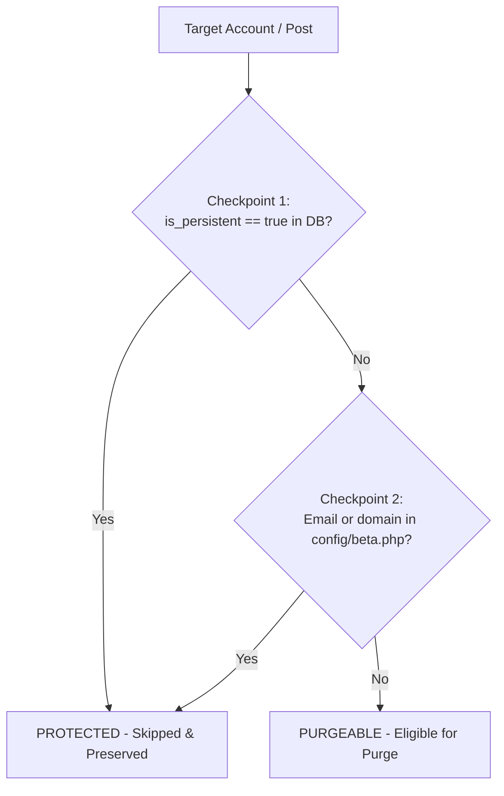

# Beta Testing Lifecycle & Data Purge Guide

This guide details Tsiyon's **Beta Testing Persistence & Purging System**. It allows the engineering and product team to run multiple beta cohorts with real testers while keeping core accounts (team, church partners, seed devotional content) permanent and surgically purging temporary test data without resetting or re-migrating the database.

---

## 1. Core Architecture & Philosophy

### Zero Database Reset Guarantee
In production and staging environments, **running `migrate:fresh` or `db:wipe` is strictly prohibited**. 
Tsiyon's beta testing lifecycle system works entirely at the application and schema layer:
* **PostgreSQL Foreign Key Cascades**: Deleting a user row automatically triggers database-level cascades across dependent tables (`profiles`, `posts`, `comments`, `likes`, `reposts`, `bookmarks`, `messages`, `notifications`, `feed_items`, `device_tokens`).
* **Cloudflare R2 / S3 Media Purging**: Physical uploaded media files (photos, videos, audio, avatars) are safely deleted from object storage before database rows are removed, preventing orphaned storage bloat.
* **Empty Conversation Pruning**: Direct messaging threads left with zero participants after tester deletion are cleaned up automatically.
* **Non-Destructive Schema Evolution**: Database migrations only advance forward via `php artisan migrate`.

---

## 2. Database Schema, Model & Environment Configuration

### Database Schema
* **Migration**: `database/migrations/2026_11_14_100000_add_is_persistent_to_users_table.php`
* **Column**: `users.is_persistent` (`BOOLEAN NOT NULL DEFAULT FALSE`)
* **Index**: `users_is_persistent_index` on `users(is_persistent)` for fast filtering in high-volume databases.

### Eloquent Model Integration (`Modules\Auth\Models\User`)
* **Casts**: `'is_persistent' => 'boolean'`
* **Mass Assignment**: `'is_persistent'` added to `$fillable`.
* **Automatic Registration Lifecycle**:
  ```php
  protected static function booted(): void
  {
      static::creating(function (User $user): void {
          if (! array_key_exists('is_persistent', $user->attributes)) {
              $user->is_persistent = ! config('beta.mode', true);
          }
      });
  }
  ```
  * During beta (`BETA_MODE=true`): new signups automatically default to `is_persistent = false`.
  * In production (`BETA_MODE=false`): all new signups automatically default to `is_persistent = true`.
* **Query Scopes**:
  * `User::persistent()`: Scopes query to permanent users (`is_persistent = true`).
  * `User::purgeable()`: Scopes query to temporary testers (`is_persistent = false`).
* **Helper Method**:
  * `$user->isPersistent()`: Evaluates DB flag, `config('beta.protected_emails')`, and `config('beta.protected_domains')`.

### Environment Variables Reference
Configure these variables in your `.env` or deployment secret manager:

| Variable | Type | Default | Description |
| :--- | :--- | :--- | :--- |
| `BETA_MODE` | Boolean | `true` | When `true`, new signups default to `is_persistent = false`. Set to `false` in production. |
| `BETA_PROTECTED_EMAILS` | Comma-delimited | `""` | Specific email addresses that can **never** be purged (e.g. `admin@tsiyonapp.com,founder@tsiyonapp.com`). |
| `BETA_PROTECTED_DOMAINS` | Comma-delimited | `"tsiyonapp.com"` | Domain names immune from purging (e.g. `tsiyonapp.com,partnerchurch.org`). |

---

## 3. Dual-Layer Protection Safeguards

To prevent accidental deletion of important team accounts, church partner profiles, or core seed data, the system enforces **two independent checkpoints**:



1. **Database Layer (`users.is_persistent = true`)**:
   A dedicated boolean column on the `users` table. When `true`, this account and its content are permanent.
2. **Configuration Layer (`config/beta.php`)**:
   An environment allowlist that acts as a hard stop:
   * Even if an administrator accidentally unsets an account's database flag or runs a broad command, matching the configuration allowlist prevents deletion.

---

## 4. Complete Command Reference

### A. Protecting an Account (`beta:protect`)
Flags an account as permanent in the database:
```bash
php artisan beta:protect admin@tsiyonapp.com
```
* **Output**: `Account 'Admin Name' (admin@tsiyonapp.com) is now marked as persistent. Its data will not be purged.`
* **Exit code**: `0` on success, `1` if user not found.

---

### B. Removing Protection (`beta:unprotect`)
Removes the persistent flag so an account can be included in future test data cleanups:
```bash
php artisan beta:unprotect oldtester@example.com
```
* **Safety Alert**: If the account's domain or email is protected in `config/beta.php`, the CLI alerts you that the account remains protected by configuration safeguards.

---

### C. Purging Tester Accounts (`beta:purge-testers`)
Purges temporary tester accounts, cleans up Cloudflare R2 / S3 files, and cascades associated database records:

```bash
php artisan beta:purge-testers [options]
```

| Option | Description | Example |
| :--- | :--- | :--- |
| `--dry-run` | Audits matching testers, posts, and media counts without modifying data. | `php artisan beta:purge-testers --dry-run` |
| `--force` | Skips interactive confirmation prompt (required for automated pipelines). | `php artisan beta:purge-testers --force` |
| `--days=N` | Only purges accounts created more than `N` days ago. | `php artisan beta:purge-testers --days=14` |
| `--email=...` | Purges only a single specified tester account and all its data. | `php artisan beta:purge-testers --email=tester@test.com` |
| `--posts-only` | **Deletes all posts** created by testers while **keeping tester accounts active** for further testing rounds. | `php artisan beta:purge-testers --posts-only` |

#### Common Usage Examples:
```bash
# 1. Preview what will be deleted (always recommended first)
php artisan beta:purge-testers --dry-run

# 2. Reset the feed while letting testers keep their accounts and passwords
php artisan beta:purge-testers --posts-only --force

# 3. Purge testers who joined more than 30 days ago
php artisan beta:purge-testers --days=30 --force

# 4. Completely purge a single tester
php artisan beta:purge-testers --email=tester@test.com --force
```

---

### D. Purging Specific Posts (`beta:purge-posts`)
Surgically deletes specific posts, their uploaded cloud media, likes, comments, and notifications **without touching user accounts**:

```bash
php artisan beta:purge-posts [options]
```

| Option | Description | Example |
| :--- | :--- | :--- |
| `--post=ID` | Purge a single post by its ULID | `--post=01JCY8Q4G06A5...` |
| `--posts=ID1,ID2` | Purge multiple comma-separated post IDs | `--posts=01JCY...,01JCZ...` |
| `--user=...` | Purge all posts by user email or `@username` | `--user=tester@example.com` |
| `--contains=...` | Purge posts containing a specific keyword (SQL wildcard escaped) | `--contains="automated smoke test"` |
| `--before=DATE` | Purge posts created before date (format: `YYYY-MM-DD`) | `--before=2026-11-01` |
| `--days=N` | Purge posts older than `N` days | `--days=7` |
| `--only-testers` | Skips posts authored by persistent accounts | `--days=3 --only-testers` |
| `--dry-run` | Previews matching posts and media without deleting | `--contains="test" --dry-run` |
| `--force` | Skips interactive confirmation prompt | `--contains="test" --force` |

#### Common Usage Examples:
```bash
# 1. Delete a single broken or inappropriate test post
php artisan beta:purge-posts --post=01JCY8Q4G06A5... --force

# 2. Delete test posts containing dummy phrases
php artisan beta:purge-posts --contains="dummy test" --force

# 3. Clean up all posts created by a specific tester while preserving their login
php artisan beta:purge-posts --user=tester@example.com --force

# 4. Remove all tester posts older than 7 days
php artisan beta:purge-posts --days=7 --only-testers --force
```

---

### E. Graduating Accounts to Production (`beta:graduate`)
Mass-promotes all remaining beta tester accounts to permanent persistent status (`is_persistent = true`):

```bash
php artisan beta:graduate [options]
```

| Option | Description |
| :--- | :--- |
| `--dry-run` | Displays a table of all non-persistent accounts that would be promoted without making changes. |
| `--force` | Skips interactive confirmation prompt. |

#### Usage:
```bash
# Preview accounts that will be promoted
php artisan beta:graduate --dry-run

# Execute graduation
php artisan beta:graduate --force
```

---

## 5. Standard Operating Procedure (Beta Cohort SOP)

Follow this lifecycle flow when running beta cohorts:

```
[1. Pre-Cohort]         [2. Live Cohort]          [3. Maintenance]          [4. Transition]
Protect Core Team   ==> Testers Sign Up    ==>   Surgical Purging   ==>    Wipe Feed / Purge
& Seed Creators         (is_persistent=f)        (Corrupt media/spam)       Prepare Next Cohort
```

### Step 1: Pre-Cohort Setup (Protect Core Data)
Before onboarding testers, ensure all team accounts and church partners are protected:
```bash
php artisan beta:protect admin@tsiyonapp.com
php artisan beta:protect pastor@gracechurch.org
```

### Step 2: Running the Testing Cohort
* Beta testers sign up normally via the mobile app or web.
* New signups automatically receive `is_persistent = false`.
* Testers create posts, upload media, write comments, like content, and message each other.

### Step 3: Mid-Cohort Maintenance (Optional)
If testers post corrupt media, inappropriate content, or test spam, surgically remove them without disrupting the cohort:
```bash
php artisan beta:purge-posts --contains="spam keyword" --force
```

### Step 4: End-of-Cohort Transition
When Cohort 1 ends and you want to prepare for Cohort 2:
* **Option A: Refresh feed but keep tester logins:**
  ```bash
  php artisan beta:purge-testers --posts-only --force
  ```
* **Option B: Total clean slate (purge all Cohort 1 testers):**
  ```bash
  php artisan beta:purge-testers --force
  ```

Your core team accounts, church partner profiles, and official seed devotionals remain completely untouched!

---

## 6. Transitioning to Production After Beta (Graduation Workflow)

When the beta period concludes and Tsiyon is ready for public production release, follow this 3-step transition procedure:

```
[Step 1: Clean Up]                [Step 2: Graduate]               [Step 3: Launch]
Purge discarded testers  ===>  php artisan beta:graduate   ===>  Set BETA_MODE=false
or keep loyal creators         (All accounts permanent)          (New signups permanent)
```

### Step 1: Clean Up Beta Test Data
1. If there are loyal beta testers or creators whose accounts should carry over into production, protect them first:
   ```bash
   php artisan beta:protect loyal_creator@example.com
   ```
2. Purge unwanted test accounts and storage files:
   ```bash
   # Wipe remaining temporary beta testers and their uploaded files
   php artisan beta:purge-testers --force

   # Or keep accounts but wipe dummy test posts
   php artisan beta:purge-testers --posts-only --force
   ```

### Step 2: Graduate All Retained Accounts to Permanent Status
Promote all accounts remaining in the database so none are flagged as purgeable beta testers:
```bash
# Preview accounts to be promoted
php artisan beta:graduate --dry-run

# Graduate all accounts to is_persistent = true
php artisan beta:graduate --force
```

### Step 3: Switch Off Beta Mode in Production
In your production environment (`.env` or server secrets manager):
```ini
BETA_MODE=false
```
Then clear and rebuild the configuration cache:
```bash
php artisan config:cache
```

**What happens in production mode (`BETA_MODE=false`):**
* Any new user registration automatically receives `is_persistent = true`.
* All user accounts and their content are permanent by default.
* Normal account deletion remains handled via the GDPR/App Store compliant user-facing deletion workflow (`/delete-account`).

---

## 7. Operational Best Practices, Safety & Backups

1. **Always Preview with `--dry-run`**:
   Before running any destructive purge, run with `--dry-run` to inspect the exact counts of accounts, posts, and media attachments that match your criteria.
2. **Take a Database Backup Before Large Purges**:
   Use Tsiyon's built-in backup suite prior to mass cohort purges:
   ```bash
   php artisan backup:run --only-db
   ```
3. **Queue Health & Object Storage**:
   Media purging deletes files synchronously from Cloudflare R2 / S3. For high-volume purges (thousands of media attachments), monitor Horizon (`/horizon`) to ensure background workers are processing normally.
4. **Cache Invalidation**:
   After mass-purging posts or testers, clear stale application caches:
   ```bash
   php artisan cache:clear
   ```

---

## 8. Frequently Asked Questions & Troubleshooting

#### Q: What happens to comments or likes made by a permanent user on a deleted beta tester's post?
**A:** When the tester's post is deleted, PostgreSQL cascades remove the interactions (comments and likes) associated with that post. The permanent user's account, profile, and their own authored posts remain completely intact.

#### Q: What happens to comments or likes made by a deleted beta tester on a permanent user's post?
**A:** When the tester account is purged, PostgreSQL cascades remove that tester's likes and comments. The permanent user's post remains intact, and interaction counts are updated.

#### Q: Why did a purge command skip a user whose database column has `is_persistent = false`?
**A:** The account matched a domain or email defined in `config/beta.php` (e.g. `@tsiyonapp.com` in `BETA_PROTECTED_DOMAINS` or an email in `BETA_PROTECTED_EMAILS`). Check your `.env` configuration.

#### Q: Can I run `php artisan migrate` safely?
**A:** Yes. `php artisan migrate` only runs pending schema changes forward. It does not alter or delete existing table records. **Never** run `migrate:fresh` or `db:wipe` in shared, staging, or production environments.
