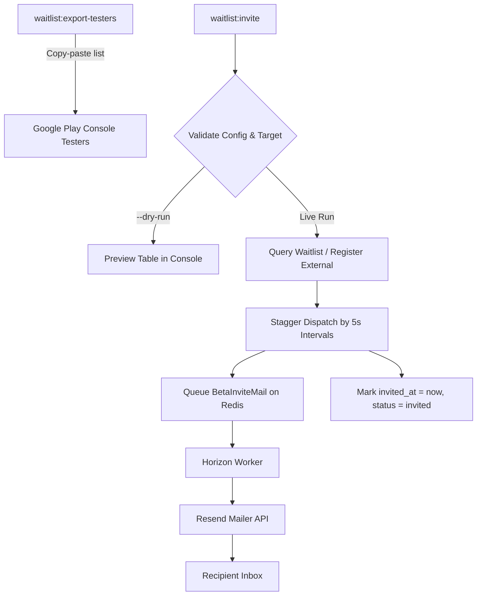

# Waitlist Beta Invite Pipeline Guide

This guide documents Tsiyon's **Waitlist Beta Invite Pipeline**. It provides a controlled, rate-limited, and idempotent system to invite early access waitlist testers to Android closed testing via Google Play Console and queued Markdown emails powered by Resend and Laravel Horizon.

---

## 1. Overview & Architecture

The beta invite pipeline automates batch invitations while adhering strictly to third-party provider limits and maintaining clean email inbox deliverability:

* **Strict Rate-Limit Protection**: Resend's free tier enforces a ceiling of **2 requests/second** and **100 emails/day**. The pipeline applies dual protection:
  * **Staggered Dispatching**: Each queued email is dispatched with an incremental 5-second delay (`now()->addSeconds($index * 5)`).
  * **Queue Middleware**: `BetaInviteMail` implements `RateLimited('resend')` backed by Laravel's `RateLimiter` (`Limit::perSecond(2)`).
* **Guaranteed Idempotency**: The `waitlist_entries.invited_at` timestamp ensures that no user is accidentally emailed twice during automated runs.
* **Flexible Targeting**: The pipeline can invite the next batch of uninvited waitlist users, target specific waitlist members, or invite external testers directly (automatically tracking them in the waitlist).
* **Google Play Console Companion Export**: A CLI export tool outputs clean email lists formatted for direct copy-pasting into Google Play Console closed testing tracks.



---

## 2. Database Schema & Model

### Database Table: `waitlist_entries`

* **Migration**: `database/migrations/2026_11_16_225322_add_invited_at_to_waitlist_entries_table.php`
* **Column**: `invited_at` (`TIMESTAMP NULL`)
* **Index**: `waitlist_entries_invited_at_index` on `invited_at` for high-performance filtering.

### Model Integration (`App\Models\WaitlistEntry`)

* **Fillable Attributes**: `email`, `source`, `ip_address`, `user_agent`, `status`, `invited_at`.
* **Casts**: `'invited_at' => 'datetime'`.
* **Query Scopes**:
  * `WaitlistEntry::uninvited()`: Filters where `invited_at IS NULL`.
  * `WaitlistEntry::pending()`: Filters where `status = 'pending'`.
  * `WaitlistEntry::invited()`: Filters where `status = 'invited'`.

---

## 3. Configuration & Environment Variables

Configure the following options in your `.env` or deployment environment:

| Variable | Type | Description | Example (Sanitized) |
| :--- | :--- | :--- | :--- |
| `MAIL_MAILER` | String | Mail driver to use. Set to `resend` in production/staging. | `resend` |
| `RESEND_API_KEY` | String | Resend API credential. | *(Secure Secret Key)* |
| `GOOGLE_PLAY_OPT_IN_URL` | URL | The Google Play web opt-in testing link for your Android app. | `https://play.google.com/apps/testing/com.example.app` |

### Service Configuration (`config/services.php`)

```php
'google_play' => [
    'opt_in_url' => env('GOOGLE_PLAY_OPT_IN_URL'),
],
```

### Rate Limiter (`app/Providers/AppServiceProvider.php`)

```php
RateLimiter::for('resend', function () {
    return Limit::perSecond(2);
});
```

---

## 4. Queued Mailable & Template

### Mailable (`App\Mail\BetaInviteMail`)

* **Queue**: `'default'` (processed by Horizon's `supervisor-general`).
* **Subject**: `"You're invited: Early Access Beta for Tsiyon on Android"`.
* **Serialization**: Implements `ShouldQueue` with `SerializesModels` to serialize cleanly across Redis.
* **Middleware**: `RateLimited('resend')`.

### Email Template (`resources/views/emails/beta-invite.blade.php`)

* **Primary Inbox Optimization**: Plain Markdown structure avoiding complex HTML or marketing templates to prevent Gmail from routing invites to the Promotions or Spam tabs.
* **Content Structure**:
  1. **Gmail Account Verification**: Reminds testers to confirm they are logged into the Google Play Store with the exact invited email.
  2. **Opt-in Action**: Direct button linking to `GOOGLE_PLAY_OPT_IN_URL`.
  3. **Installation Steps**: Clear instructions on clicking "Become a Tester" and downloading the build.
  4. **Retention Notice**: Highlights the 14-day retention requirement for closed testing.
  5. **Feedback Loop**: Explains how to submit feedback directly within the app (**Settings > Give Feedback**).
  6. **Opt-out Footer**: Transparent notice explaining why they received the message.

---

## 5. Artisan Commands Reference

### 1. Batch Invitation Command: `waitlist:invite`

Dispatches early access beta invites in controlled batches.

```bash
php artisan waitlist:invite {limit=15} {--emails=*} {--dry-run} {--force}
```

#### Arguments & Options

* `{limit=15}`: Maximum number of uninvited users to process. Defaults to 15.
* `{--emails=*}`: Specific email address(es) to invite. Accepts single, multiple, or comma-separated values. If an email is not on the waitlist, it is automatically created and tracked with `source: 'manual_invite'`.
* `{--dry-run}`: Previews the matched recipients in a formatted console table without modifying the database or dispatching emails.
* `{--force}`: Forces re-sending an invite even if the recipient was already marked as invited previously (useful for developer re-testing).

#### Usage Examples

```bash
# Preview the next 10 uninvited waitlist users
php artisan waitlist:invite 10 --dry-run

# Invite the next 10 uninvited waitlist users (prioritizes @gmail.com)
php artisan waitlist:invite 10

# Preview inviting an external tester not yet on the waitlist
php artisan waitlist:invite --emails=tester@gmail.com --dry-run

# Invite specific email addresses (automatically registers them if missing)
php artisan waitlist:invite --emails=tester1@gmail.com,tester2@gmail.com

# Re-send an invite to an already invited tester for verification
php artisan waitlist:invite --emails=tester1@gmail.com --force
```

---

### 2. Tester Export Command: `waitlist:export-testers`

Exports uninvited `@gmail.com` addresses for easy copy-pasting into Google Play Console.

```bash
php artisan waitlist:export-testers {limit=20} {--lines}
```

#### Arguments & Options

* `{limit=20}`: Maximum number of uninvited Gmail addresses to retrieve. Defaults to 20.
* `{--lines}`: Outputs each email on a new line instead of comma-separated.

#### Usage Examples

```bash
# Export comma-separated list (default, ready for Google Play Console input)
php artisan waitlist:export-testers 25

# Export newline-separated list
php artisan waitlist:export-testers 25 --lines
```

---

## 6. End-to-End Release Workflow

When conducting an Android closed beta release with Google Play Console:

1. **Export the Next Tester Cohort**:
   ```bash
   php artisan waitlist:export-testers 20
   ```
2. **Add Testers in Google Play Console**:
   * Navigate to **Google Play Console > Release > Testing > Closed testing**.
   * Select your testing track and click **Testers**.
   * Paste the comma-separated email list into your email list and click **Save changes**.
3. **Preview the Invite Batch**:
   ```bash
   php artisan waitlist:invite 20 --dry-run
   ```
4. **Dispatch the Batch**:
   ```bash
   php artisan waitlist:invite 20
   ```
5. **Monitor Throughput**:
   * Monitor queued jobs in the Laravel Horizon dashboard (`/horizon`).
   * Horizon distributes the jobs across Redis with staggered delays, keeping throughput safely below provider thresholds.

---

## 7. Testing & Verification

The pipeline is covered by comprehensive feature tests in [SendBetaInvitesTest.php](file:///Users/serene/php_projects/zion-backend-php/zion-backend-php/tests/Feature/SendBetaInvitesTest.php):

```bash
vendor/bin/phpunit tests/Feature/SendBetaInvitesTest.php
```

### Covered Test Cases
* **Batch Limiting & Progression**: Confirms batch limits work as specified and subsequent runs only target remaining uninvited users.
* **Idempotency Guarantee**: Ensures already-invited rows are skipped.
* **Dry Run Verification**: Verifies zero emails are queued and the database remains untouched during dry runs.
* **Targeted Email Filtering**: Tests explicit `--emails` filtering.
* **External Tester Auto-Registration**: Confirms unlisted emails are added to `waitlist_entries` and tracked correctly.
* **Re-Invite Flag (`--force`)**: Tests intentional re-sending behavior.
* **Missing Config Handling**: Confirms graceful failure when `GOOGLE_PLAY_OPT_IN_URL` is unset.
* **Export Formatting**: Validates comma-separated and newline-separated tester exports.
* **Queue Serialization & Rendering**: Verifies that `BetaInviteMail` serializes across Redis without closure issues and renders all Markdown components cleanly.
